# Doctor Tracker — Frontend

> This repository is the **Next.js frontend**. The REST API lives in **[Doctor-Tracker-Backend](https://github.com/fahimor/Doctor-Tracker-Backend)**.

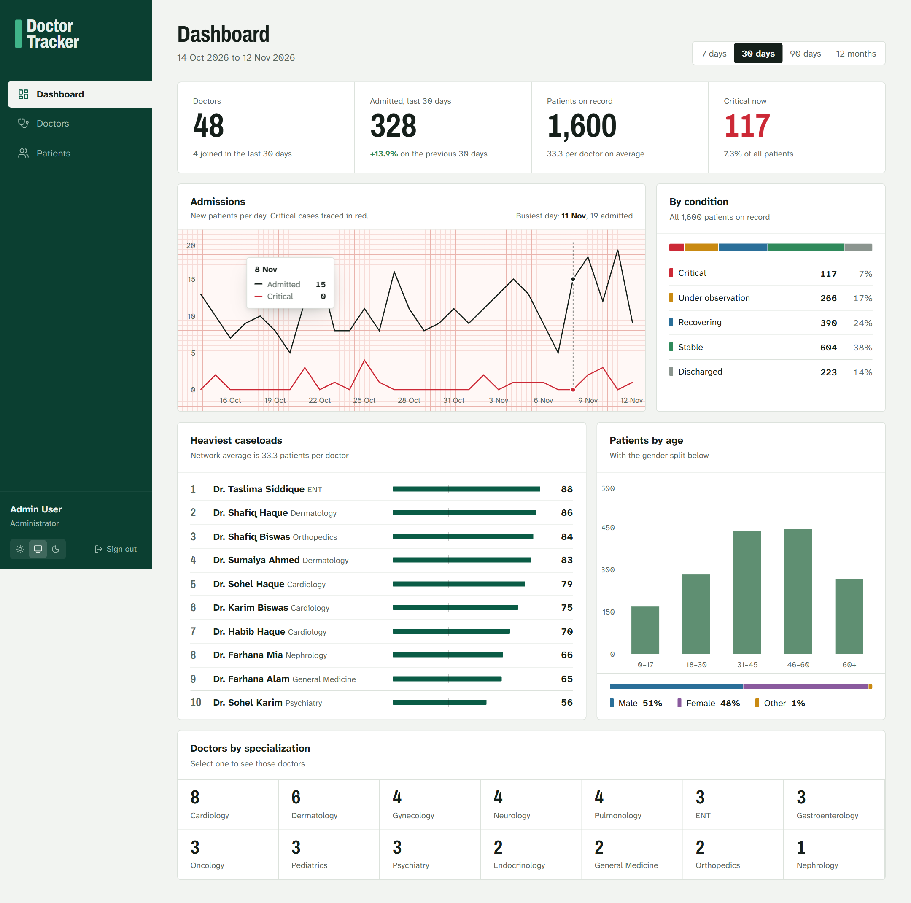

## Description

**Doctor Tracker** is a secure admin portal for hospital and clinic operations teams. Admins use it to manage doctors and the patients under each doctor's care. They can register doctors, add, edit and remove patients, and find any record quickly with indexed search, filters and pagination. A live analytics dashboard shows total doctors and patients, each doctor's caseload, admission trends, patient conditions and demographics. The project has two parts: a **Next.js 16** frontend (deployed to Vercel) and a stateless **Express 5 + MongoDB** REST API (deployed to Google Cloud Run). Authentication uses httpOnly cookies, and access is controlled by role (admin or viewer).

| | |
| --- | --- |
| **Frontend** | Next.js 16 (App Router, Cache Components), React 19, TypeScript, Tailwind CSS 4, TanStack Query 5, React Hook Form + Zod, Recharts |
| **Backend** | Node.js 24, Express 5, TypeScript, Mongoose 9, Zod 4, JWT (httpOnly cookie), bcrypt, Helmet, rate limiting, Pino |
| **Database** | MongoDB (Atlas in production) |
| **Testing** | Vitest + Supertest + mongodb-memory-server (20 API integration tests, including query-plan checks) |
| **Hosting** | Vercel (frontend) · Google Cloud Run (backend, Docker) · MongoDB Atlas |

**Demo accounts** (created by the seed script):

| Role | Email | Password | Can do |
| --- | --- | --- | --- |
| Admin | `admin@doctortracker.dev` | `Admin@12345` | Everything |
| Viewer | `viewer@doctortracker.dev` | `Viewer@12345` | Read-only (write actions are hidden in the UI and rejected by the API with 403) |

---

## Design

The interface is designed as a ward's case file rather than a generic SaaS dashboard:

- **Palette:** paper and white sheets, ink text, and a deep ward green taken from Bangladesh's national green. Red is reserved for critical patients, and patient conditions use triage colours (critical, under observation, recovering, stable, discharged) wherever they appear.
- **Type:** [Atkinson Hyperlegible Next](https://www.brailleinstitute.org/freefont/) for all UI text. It was designed by the Braille Institute for low-vision readers, and its distinct 0/O and 1/l help with phone numbers and IDs. Condensed *Archivo* is used for page titles and census numbers, like a ward census board.
- **Layout:** a green navigation rail whose active item is a folder tab running into the page. On mobile this becomes a bottom tab bar. Hierarchy comes from hairline rules and spacing, not shadows.
- **Signature:** admissions are plotted as a trace on ECG chart paper (millimetre grid, ink line, critical cases in red). It prints once, left to right, on load and respects reduced-motion settings.

## Features

- **Authentication**: login with an httpOnly JWT cookie, every page protected by `proxy.ts`, every API route protected by middleware, admin/viewer roles, brute-force rate limiting, and automatic redirect to login when the session expires.
- **Doctors**: create, edit and delete doctors. The list has search, filters (specialization, hospital, join-date range), sorting (newest, name, or most / fewest patients, also by clicking the Patients column) and pagination. Each doctor has a profile page with patient stats, and you can add patients to a doctor or remove them from that doctor's list.
- **Patients**: a dedicated page listing every patient, with edit (including moving a patient to another doctor) and delete. Search covers name, phone, email and diagnosis. Filters cover condition, gender, admission-date range and age range, with six sort orders and pagination.
- **Dashboard**: totals, new admissions compared with the previous period, admissions over time (per day, week or month), patients by condition, top 10 doctors by caseload, doctors by specialization, and age and gender breakdowns. You can switch between 7-day, 30-day, 90-day and 12-month ranges.
- **UX**: responsive layout (sidebar on desktop, drawer and cards on mobile), light/dark/system themes, skeleton loaders, empty and error states, toasts, confirmation dialogs, keyboard-accessible dialogs and combobox, and filter state stored in the URL so views can be shared.

---

## Setup Guide

### Prerequisites

- **Node.js 20.12+** (built and tested on Node 24)
- One of these MongoDB options:
  - **None:** `npm run dev:memory` starts an in-memory MongoDB with seeded data. Nothing to install.
  - **MongoDB Atlas** (free M0 cluster), or
  - a local MongoDB (`docker compose up -d` uses the included `docker-compose.yml`)

### 1. Clone and install both repositories

```bash
mkdir doctor-tracker && cd doctor-tracker
git clone https://github.com/fahimor/Doctor-Tracker-Backend.git backend
git clone https://github.com/fahimor/Doctor-Tracker-Frontend.git frontend

cd backend && npm install
cd ../frontend && npm install
```

### 2. Configure environment variables

Each app has an `.env.example` file that documents every variable:

```bash
cp backend/.env.example backend/.env           # set MONGODB_URI and JWT_SECRET
cp frontend/.env.example frontend/.env.local   # defaults already point to http://localhost:8080
```

| File | Key variables |
| --- | --- |
| [`backend/.env.example`](https://github.com/fahimor/Doctor-Tracker-Backend/blob/main/.env.example) | `MONGODB_URI`, `JWT_SECRET` (32+ chars), `CORS_ORIGINS`, `COOKIE_*`, `TRUST_PROXY`, `BOOTSTRAP_ADMIN_*` |
| [`frontend/.env.example`](.env.example) | `API_PROXY_TARGET`, optional `JWT_SECRET`, `NEXT_PUBLIC_SHOW_DEMO_ACCOUNTS` |

### 3. Run the backend (port 8080)

**Option A: zero setup (in-memory MongoDB with demo data):**

```bash
cd backend
npm run dev:memory
```

**Option B: your own MongoDB:**

```bash
cd backend
npm run seed     # demo users + 48 doctors + 1,600 patients (wipes doctors/patients)
npm run dev      # watch mode
```

### 4. Run the frontend (port 3000)

```bash
cd frontend
npm run dev
```

Open <http://localhost:3000> and sign in with a demo account. The login page has one-click buttons that fill them in.

### 5. Tests and production builds

```bash
cd backend  && npm test && npm run build      # 20 integration tests, then tsc build
cd frontend && npm run lint && npm run build  # ESLint, then Next.js production build
```

Deploying to **Cloud Run + Vercel** is covered step by step in [docs/DEPLOYMENT.md](docs/DEPLOYMENT.md).

---

## System Architecture

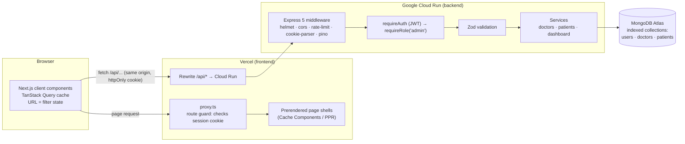

### Request flow: "show critical patients admitted since June"

1. The user picks filters, and the URL becomes `/patients?condition=critical&from=2026-06-01`. The URL is the single source of truth for filters, so the view can be shared and the back button works.
2. `usePatients(params)` (TanStack Query) checks its cache under the key `["patients","list",{...params}]`. On a miss it calls `fetch("/api/patients?condition=critical&from=2026-06-01")`. The previous page stays visible while the request runs, and the next page is prefetched afterwards.
3. Vercel **rewrites** `/api/*` to the Cloud Run service. The browser has only talked to its own origin, so the `dt_session` cookie is sent automatically.
4. Express runs `helmet`, `cors`, the rate limiter, then `requireAuth`, which verifies the JWT (HS256, issuer and audience) and sets `req.user`.
5. `validate(listPatientsSchema)` runs **Zod**: it coerces and checks the query string, rejects bad input with a `400` and field-level details, and the controller only ever sees typed data.
6. `patient.service` builds an indexed filter. `find()` (with sort, skip, limit and `lean`) and `countDocuments()` run **in parallel**, and the doctor names are joined in one batched query (`populate`, which uses `$in`).
7. MongoDB answers from the `{ condition: 1, admissionDate: -1, _id: -1 }` compound index. It reads exactly the 10 rows on the page in order, with no collection scan and no in-memory sort. The tests check this with `explain()`.
8. The response comes back as `{ data, meta: { page, limit, total, totalPages, ... } }`. The table re-renders only the rows that changed, because rows are memoized and callbacks are stable.

Writes (create, update, delete) invalidate the affected query keys (patients, doctors and dashboard), so every view refreshes itself.

### Backend layering

```
routes  →  middleware (auth, role, validate)  →  controller  →  service  →  Mongoose model
                                                (HTTP only)    (business logic + queries)
```

### Project structure

The project is split across two repositories ([frontend](https://github.com/fahimor/Doctor-Tracker-Frontend), [backend](https://github.com/fahimor/Doctor-Tracker-Backend)):

```
.
├── backend/                     Express REST API (deployed to Cloud Run) — Doctor-Tracker-Backend repo
│   ├── src/
│   │   ├── app.ts               Express app: security middleware, routes, error handling
│   │   ├── server.ts            Boot: DB connect, listen on $PORT, graceful SIGTERM shutdown
│   │   ├── config/              env (Zod-validated), db connection pool, logger
│   │   ├── middleware/          requireAuth / requireRole, validate (Zod), error handler
│   │   ├── modules/
│   │   │   ├── auth/            login / logout / me, JWT + cookie handling
│   │   │   ├── users/           User model
│   │   │   ├── doctors/         model (+indexes), schema, service, controller, routes
│   │   │   ├── patients/        model (+indexes), schema, service, controller, routes
│   │   │   └── dashboard/       aggregation pipelines for analytics
│   │   ├── utils/               search tokens, pagination, dates, ApiError, validators
│   │   └── scripts/             seed, in-memory dev server
│   ├── tests/                   Vitest + Supertest integration tests
│   └── Dockerfile               multi-stage, non-root image for Cloud Run
├── frontend/                    Next.js app (deployed to Vercel) — this repo
│   └── src/
│       ├── app/                 routes: /login, (app)/dashboard, doctors, doctors/[id], patients
│       ├── proxy.ts             route protection (redirects to /login)
│       ├── components/ui/       reusable design-system components
│       ├── components/layout/   app shell, sidebar, theme toggle, user card
│       ├── features/            auth, dashboard, doctors, patients (API hooks + views)
│       ├── hooks/               useUrlFilters, useDebouncedValue, useHydrated
│       └── lib/                 api client, query keys, constants, utils
    └── docs/                    deployment guide, screenshots
```

### REST API

All routes are under `/api`. Every route except `/auth/login` and `/auth/logout` requires a session. Routes marked 🔒 also require the `admin` role.

| Method | Path | Description |
| --- | --- | --- |
| `POST` | `/auth/login` | Sign in; sets the `dt_session` httpOnly cookie (rate limited) |
| `POST` | `/auth/logout` | Clear the session cookie |
| `GET` | `/auth/me` | Current user |
| `GET` | `/dashboard/stats?range=7d\|30d\|90d\|12m` | All dashboard analytics in one call |
| `GET` | `/doctors?page&limit&q&specialization&hospital&from&to&sort` | Paginated, searchable, filterable list (with `patientCount`). `sort`: `newest`, `oldest`, `name_asc`, `name_desc`, `patients_desc`, `patients_asc` |
| `GET` | `/doctors/facets` | Distinct specializations and hospitals (for filter dropdowns) |
| `GET` | `/doctors/options?q&limit` | Lightweight searchable list for the doctor picker |
| `POST` 🔒 | `/doctors` | Create a doctor |
| `GET` | `/doctors/:id` | Doctor and patient stats by condition |
| `PATCH` 🔒 | `/doctors/:id` | Update a doctor |
| `DELETE` 🔒 | `/doctors/:id` | Delete a doctor and their patients |
| `GET` | `/doctors/:id/patients?…` | That doctor's patients (same filters as `/patients`) |
| `POST` 🔒 | `/doctors/:id/patients` | Add a patient under this doctor |
| `DELETE` 🔒 | `/doctors/:id/patients/:patientId` | Remove a patient from this doctor's list |
| `GET` | `/patients?page&limit&q&condition&gender&doctor&from&to&minAge&maxAge&sort` | Paginated, searchable, filterable list |
| `POST` 🔒 | `/patients` | Create a patient (body includes `doctor`) |
| `GET` | `/patients/:id` | One patient |
| `PATCH` 🔒 | `/patients/:id` | Update or reassign a patient |
| `DELETE` 🔒 | `/patients/:id` | Delete a patient |
| `GET` | `/health` (no `/api`) | Liveness/readiness check, including database status |

Errors always have the same shape: `{ "error": { "code": "VALIDATION_ERROR", "message": "...", "details": [{ "path": "email", "message": "..." }] } }`.

---

## Technical Decisions

### 1. Same-origin API proxy + httpOnly cookie, rather than a JWT in localStorage or cross-site cookies

**Problem.** The frontend (Vercel) and backend (Cloud Run) live on different domains. The usual options both have real downsides:

- **JWT in `localStorage` + `Authorization` header:** any XSS bug can read and steal the token, and server-side route protection (`proxy.ts`) cannot see it, so protected pages flash before the client redirects.
- **Cross-site cookie (`SameSite=None`) set by the Cloud Run domain:** this is a *third-party* cookie from the browser's point of view. Safari blocks it, Chrome restricts it, and every request also needs CORS preflights.

**Decision.** The browser only ever calls its **own origin** (`/api/*`). A Next.js rewrite in `next.config.ts` forwards those requests to Cloud Run at the edge. The backend sets the JWT in a cookie that is `httpOnly`, `Secure` and `SameSite=Lax`, and because of the proxy that cookie is first-party on the Vercel domain.

**What we get**
- JavaScript cannot read the token, which removes the main XSS token-theft path.
- No third-party-cookie or CORS problems in any browser.
- `SameSite=Lax`, a JSON-only API and a CORS allow-list together block CSRF.
- `src/proxy.ts` can read the cookie and redirect unauthenticated users *before* any page renders. With `JWT_SECRET` set, it also verifies the signature.
- Postman and scripts can still call the API with a `Bearer` header.

**Trade-offs.** API calls take one extra hop through Vercel's edge (a few ms). Sessions are stateless JWTs, so a token stays valid until it expires (12 hours). To keep that window safe, roles are checked server-side on every call, `/auth/me` re-checks that the user still exists, and the client clears the cookie and logs the user out on any 401. A refresh-token rotation scheme or a server-side denylist would be the next step if instant revocation were required.

### 2. TanStack Query + URL search params, rather than Redux (or Context)

**Problem.** Almost all state in this app is **server state** (lists, details, stats) that must be cached, deduplicated, refetched after writes and paginated. The rest is **filter state** that users expect to bookmark and share.

**Decision.**
- **TanStack Query** owns server state. A hierarchical key factory (`lib/query-keys.ts`) makes invalidation precise: creating a patient invalidates `patients`, `doctors` (counts) and `dashboard`, and nothing else. It also provides request deduplication, `AbortSignal` cancellation when filters change quickly, the previous page kept visible during loading (no layout jump), next-page prefetching and retries limited to 5xx errors. All of this would be hand-written reducers, thunks and cache logic in Redux.
- **The URL** owns filter state (`hooks/use-url-filters.ts`). Every list view can be shared, the back button works, and the URL params *are* the query key. Search input is debounced (300 ms), so typing does not send one request per keystroke.
- Small UI state (dialogs, the drawer) stays in local `useState`.

**Why not Redux?** It would mean writing a cache, loading flags and invalidation by hand, plus a lot of boilerplate, for a problem that is fundamentally server-cache synchronisation. **Why not Context?** Every consumer re-renders whenever any part of the value changes, and Context has no caching. Redux (or Zustand) becomes worth it once the app has substantial *client-only* shared state, such as a multi-step editor or offline drafts.

### Bonus: indexed prefix search instead of `$regex: /term/i`

A case-insensitive "contains" regex cannot use an index, so it scans the whole collection. Each document instead stores `searchTokens`, the lower-cased words of its searchable fields, behind a **multikey index**. A query like `"rah card"` becomes `{ searchTokens: { $all: [/^card/, /^rah/] } }`. Anchored, case-sensitive regexes turn into tight index range scans. This gives instant prefix matching across name, email, phone, hospital and specialization, and `explain()` in the tests confirms the index is used. If full fuzzy search were ever needed, the upgrade path is MongoDB Atlas Search.

### Other performance and scalability choices

- **Every index serves a specific query** and follows ESR (Equality, Sort, Range), for example `{ doctor: 1, admissionDate: -1, _id: -1 }` and `{ condition: 1, admissionDate: -1, _id: -1 }`. `_id` is the last sort key so pages stay stable, and it is also the last index key, so MongoDB streams a page straight from the index instead of reading every match and sorting in memory. On Atlas this cut "critical patients, latest first" from 117 documents read to 10, and the age sort from a full collection scan to 24.
- **Denormalised caseload counter:** each doctor stores `patientCount`, updated atomically with `$inc` whenever a patient is added, deleted or moved to another doctor. Doctor lists can therefore sort by most or fewest patients straight from the `{ patientCount: -1, _id: -1 }` index (10 documents read for a page), the list needs no extra counting query, and the dashboard's top-10 caseloads is an index read instead of a `$group` over every patient. `npm run db:recount` rebuilds the counters if they ever drift.
- **No N+1 queries:** doctor names on patient rows come from one batched `$in` lookup per page.
- **Parallel queries:** the page query and the count query run in parallel. With no filters, the count uses `estimatedDocumentCount()` (O(1) collection metadata).
- **Dashboard:** about 9 independent queries run in parallel. The three patient breakdowns share a single `$facet`, so the collection is read once. The top-10 caseloads are read from the `patientCount` index, and empty time buckets are filled in so the timeline has no gaps.
- **Frontend:** Recharts is code-split with `next/dynamic` and loads only on the dashboard. Page shells are prerendered with Cache Components. Table rows are memoized with stable callbacks.
- **Scaling:** the API is stateless (JWT), so Cloud Run can scale horizontally. Each instance keeps one pooled Mongo connection (`maxPoolSize: 10`) and shuts down cleanly on SIGTERM. Next steps at larger scale: cursor-based pagination for deep pages, a materialized view refreshed with `$merge` for dashboard stats, and Atlas Search.

---

## Visual Evidence

### Desktop

| Dashboard (light) | Dashboard (dark) |
| --- | --- |
|  | 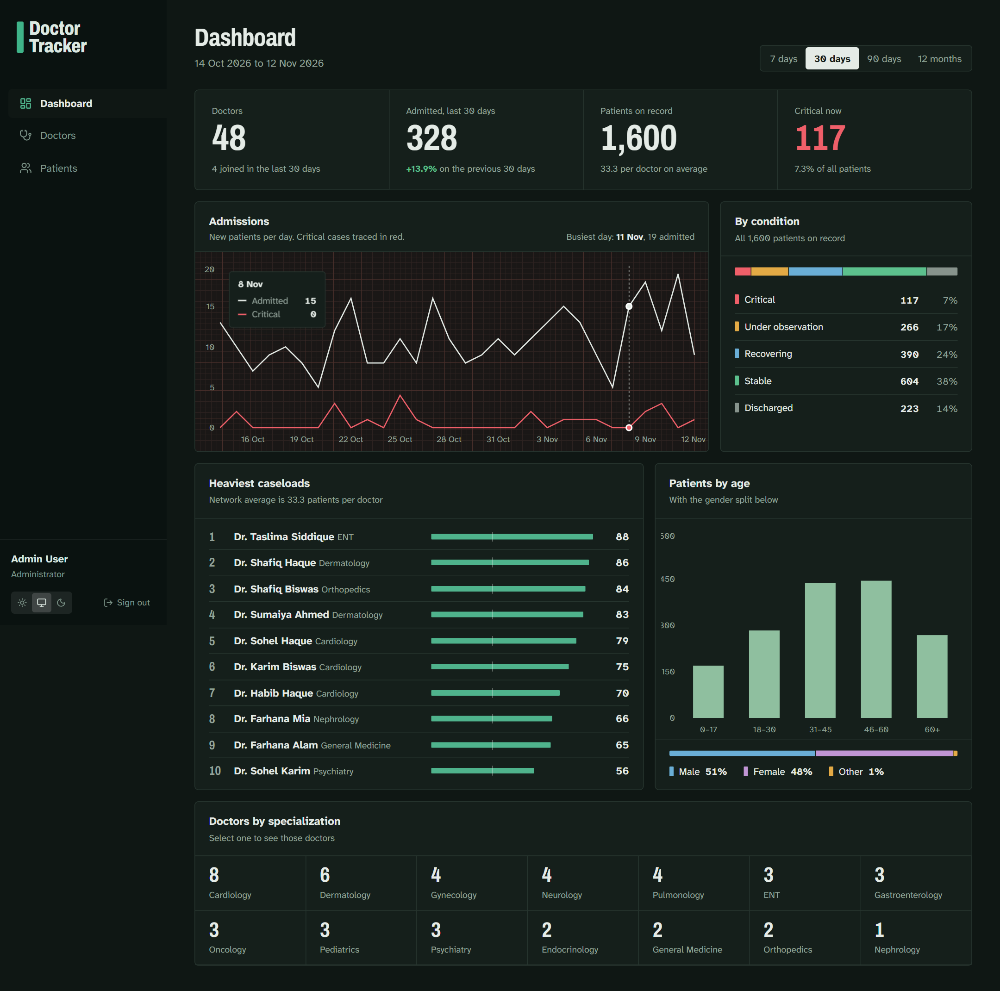 |

| Doctors | Doctors, filtered by specialization |
| --- | --- |
| 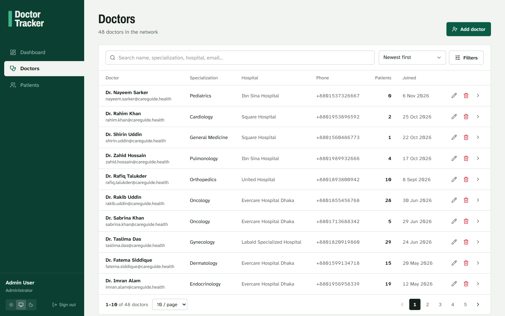 | 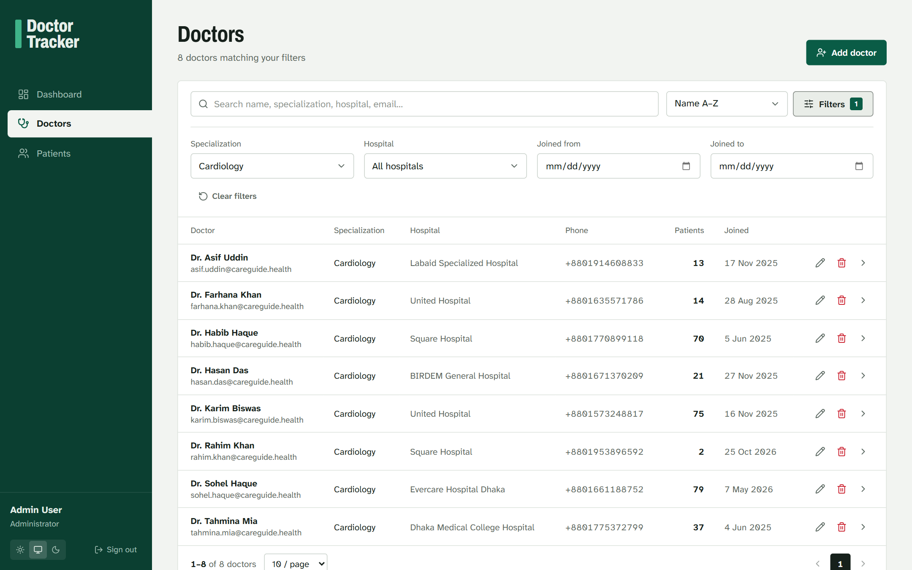 |

| Doctor profile + patients | Add patient dialog |
| --- | --- |
| 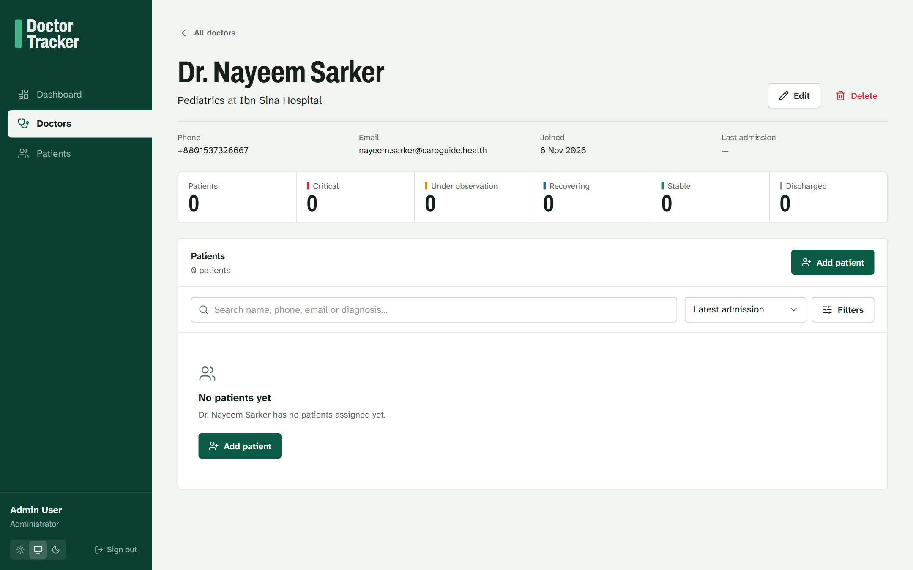 | 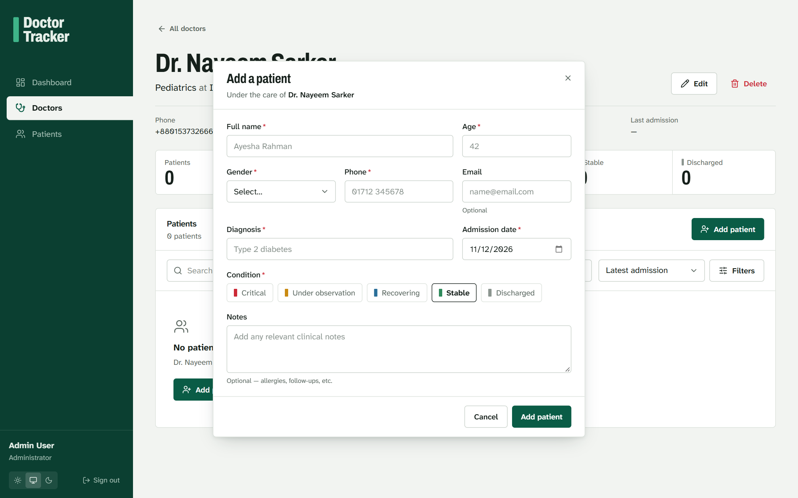 |

| Patients (critical, admitted since June) | Login |
| --- | --- |
| 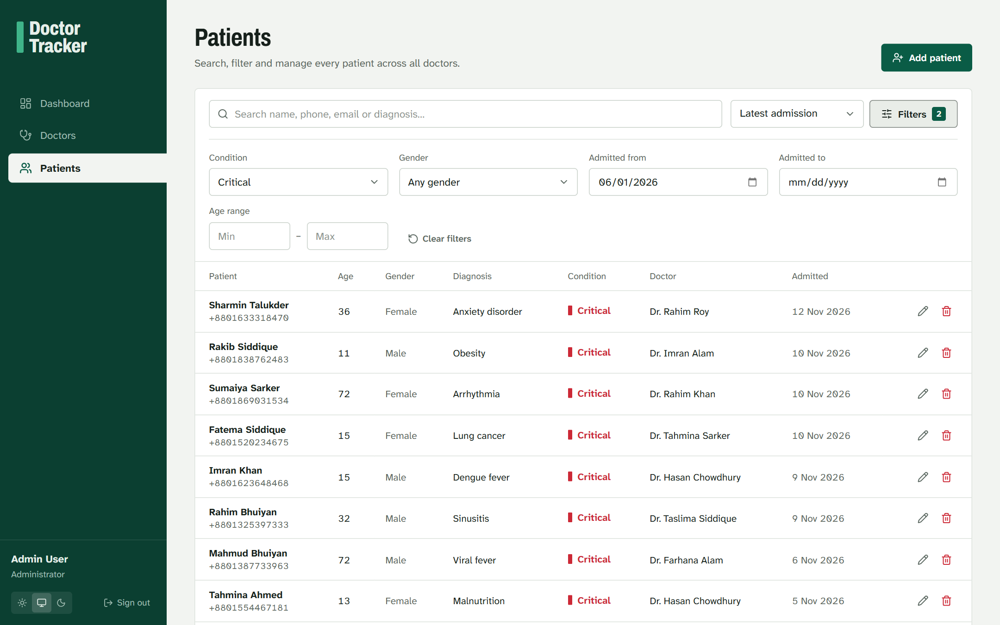 | 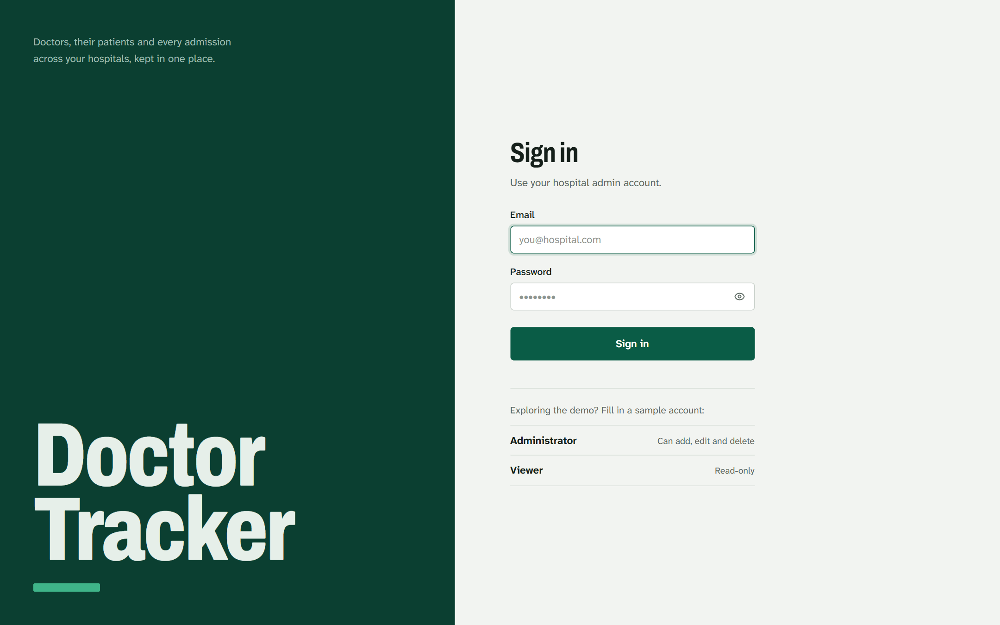 |

### Mobile

| Login | Dashboard | Account menu | Doctors | Patients |
| --- | --- | --- | --- | --- |
| 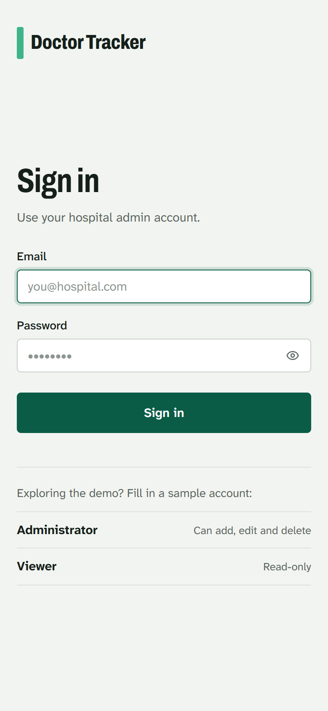 | 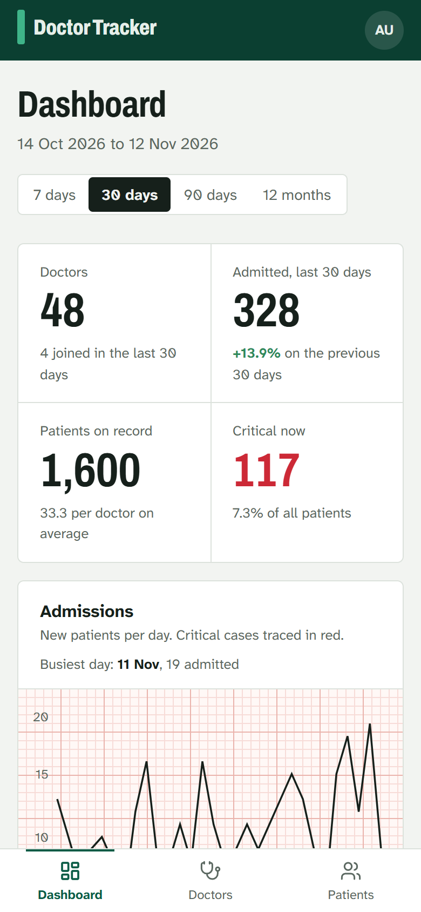 | 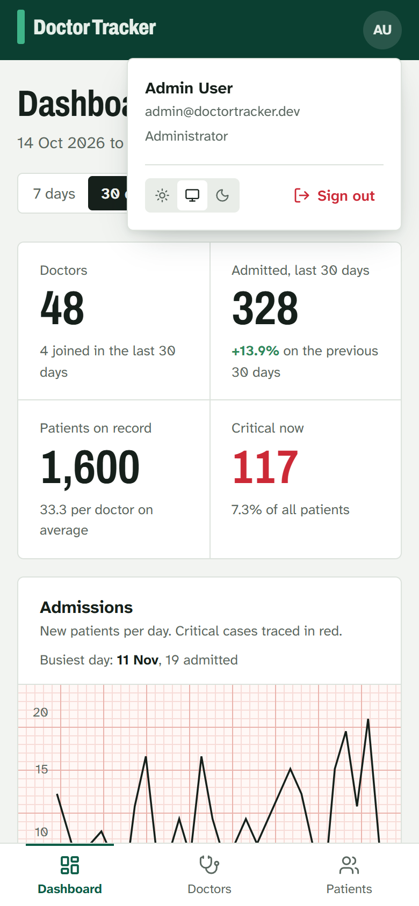 | 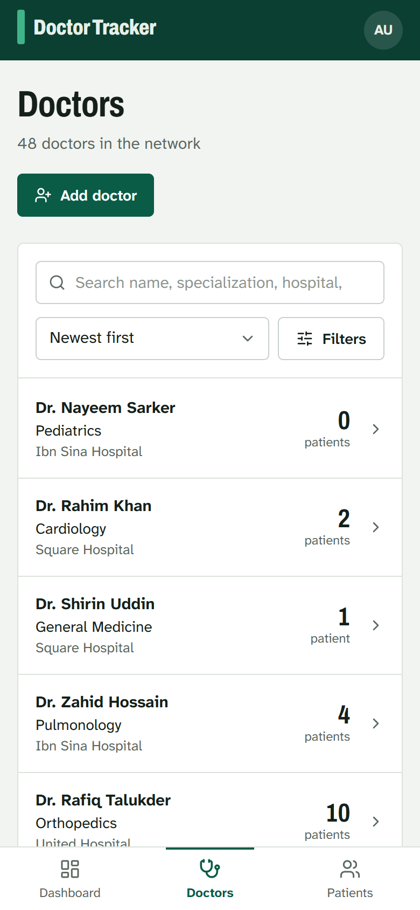 | 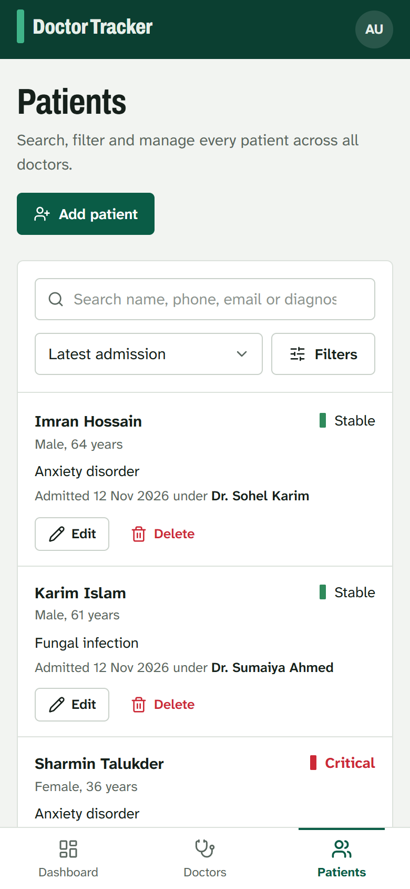 |

---

## More documentation

- [docs/DEPLOYMENT.md](docs/DEPLOYMENT.md): MongoDB Atlas, Cloud Run and Vercel, step by step
- [Backend repository](https://github.com/fahimor/Doctor-Tracker-Backend): API source, tests, Dockerfile
